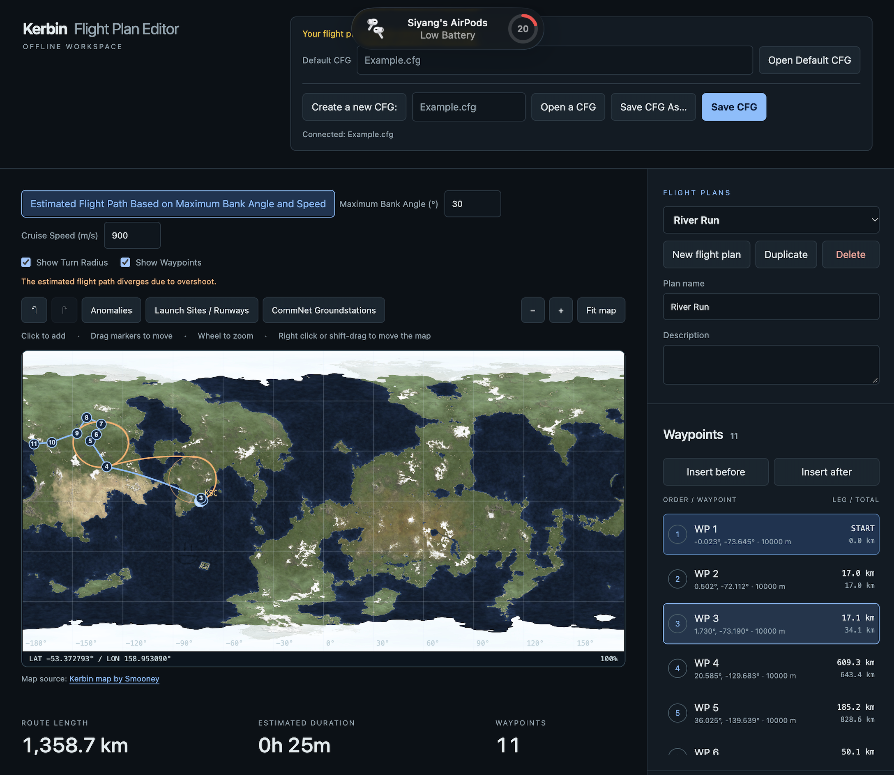
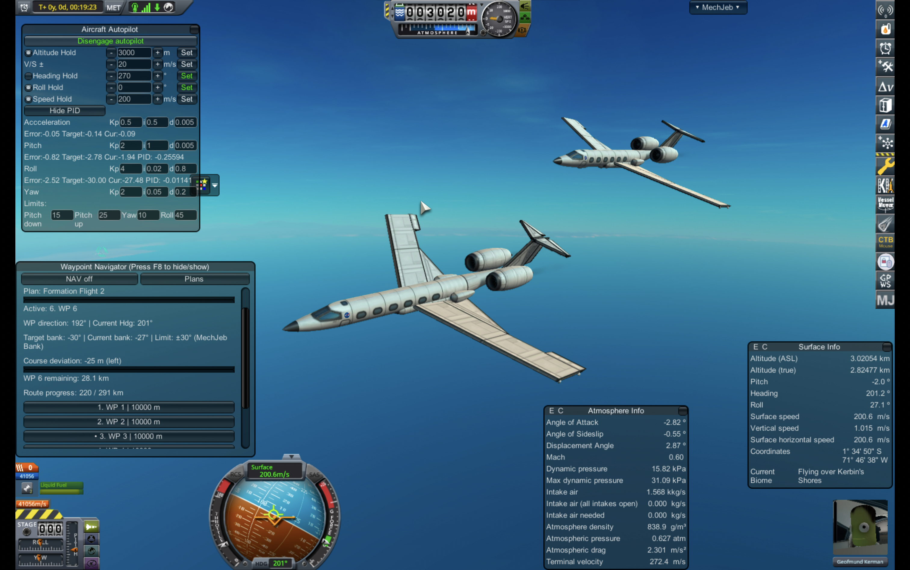

# MechJeb Waypoint Navigator

**Draw a flight route on a Kerbin map. Let your aircraft fly it automatically.**

- **Flight Plan Editor** — An interactive, offline map for creating routes and previewing turns.
- **Waypoint Navigator** — Follows your route using MechJeb Aircraft Autopilot.
- **Multi-aircraft NAV (v1.2.0)** — Fly multiple aircraft along independent flight plans simultaneously, as long as they remain within KSP's active physics range.

### Video Demonstration — Multi-Aircraft NAV (v1.2.0)

[**Watch the demonstration on YouTube (6:27)**](https://youtu.be/7WIXcDXlVmw)

Two aircraft independently following waypoint routes, with close formation flying achieved through manual speed adjustments.

Inspired by [RCTestFlight's waypoint missions](https://youtu.be/vYeYZpBE51I). Uses [Kramax directional guidance](https://forum.kerbalspaceprogram.com/topic/150846-112x-kramax-autopilot-continued-course-guidance-and-auto-land-for-spaceplanes/) and the [Kerbin map from Micro Map by KerbalMissile](https://github.com/KerbalMissile/Micro-Map) (MIT license).

## Download & Install

**1. Download**

[**Download MechJeb-Waypoint-Navigator (ZIP)**](https://github.com/siyang03/MechJeb-Waypoint-Navigator/releases/latest/download/MechJeb-Waypoint-Navigator.zip)

**2. Install**

Requires **KSP 1**, [MechJeb2](https://github.com/MuMech/MechJeb2), and **KSP Harmony 2** (`000_Harmony`, available on CKAN).

Extract the ZIP and copy `MechJebWaypointNavigator` into your KSP `GameData` folder. On updates, preserve your existing CFG flight plans.

**3. Launch Flight Plan Editor**

Open `GameData/MechJebWaypointNavigator/Launch the Editor.html` in **Chrome or Edge**. No installation or internet connection required.

## Quick Start — Plan & Fly

**1. Draw your route**

Open **Flight Plan Editor**, click the Kerbin map to add waypoints, and drag them to adjust your route.

Save your flight plan as a `.cfg` file directly in `GameData/MechJebWaypointNavigator/` (not inside a subfolder).

**⚠️ Browser compatibility:** Only **Chrome and Edge** are supported. Firefox and Safari are not supported.

**2. Set up MechJeb**

In flight, enable **MechJeb Aircraft Autopilot**.

Configure your desired altitude, speed, **BankAngle**, and **RollLimit**. Click **Set** to apply changes to BankAngle (a green Set button means the new value hasn't been applied).

Higher bank limits allow tighter turns and reduce waypoint overshoot. The Navigator's effective bank limit is **min(BankAngle, RollLimit)**.

**3. Engage navigation**

Open **Waypoint Navigator → Plans**, refresh the CFG files, and select your flight plan.

Press **NAV on**. Your aircraft will follow the waypoints automatically!

## Good to Know

- **Altitude and speed:** NAV controls horizontal navigation only. Waypoint altitudes are informational; set Altitude Hold and Speed Hold separately in MechJeb.
- **Bank limits:** NAV displays the live effective limit and its source: `(MechJeb Roll)`, `(MechJeb Bank)`, or `(MechJeb)` when both limits are equal. Actual aircraft bank may exceed the commanded value.
- **Yaw control:** NAV normally uses MechJeb's yaw stabilization. If incompatible, it falls back to passive aerodynamic yaw stability, which may be less reliable on some aircraft.
- **SAS:** NAV automatically turns SAS off when engaged and back on when disengaged. Manually enabling SAS or MechJeb Heading Hold disengages NAV.
- **Waypoints:** Select another waypoint during NAV to redirect the aircraft without interrupting navigation.
- **Turn predictions:** The editor estimates turn paths using the selected speed and bank angle. These are estimates, not guarantees; high-speed sharp turns may overshoot.
- **F8** hides or shows the Navigator window.

## Multi-aircraft Navigation (v1.2.0)

Starting with v1.2.0, multiple aircraft can independently follow their own flight plans at the same time.

**How to use:**

1. Enable MechJeb Aircraft Autopilot on aircraft A, select its route, and engage NAV.
2. Switch to aircraft B while A remains within physics range.
3. Enable MechJeb Aircraft Autopilot on B, select its route, and engage NAV.
4. Both aircraft will continue following their respective routes. You can switch between them to monitor or adjust their navigation.

Each aircraft remembers its selected CFG, flight plan, waypoint progress, and navigation state. The Navigator window always controls the currently active aircraft. **NAV off** and waypoint selections affect only that aircraft. The window also displays the total number of active NAV sessions.

**Important limitations:**

- Aircraft must remain **loaded and unpacked** within KSP's active physics range. The applicable distance depends on game settings and circumstances.
- If an aircraft becomes packed or unloaded, its NAV automatically disengages. It must be reengaged manually when the aircraft becomes available again.
- Each aircraft requires its own enabled MechJeb Aircraft Autopilot, with altitude and speed configured independently.
- Leaving the flight scene disengages all NAV sessions. Navigation does not automatically resume after reloading.
- The mod does not simulate background flight, coordinate aircraft speeds, maintain formations, or avoid collisions.

**Testing:** Simultaneous two-aircraft navigation has been successfully tested in KSP, including flying two aircraft on the same route and bringing them into close proximity through manual speed adjustments. Larger formations and the full set of failure/recovery scenarios have not yet been flight-tested.

See the [multi-aircraft test checklist](Source/Navigator/docs/MULTI_VESSEL_TEST_PLAN.md) for additional validation scenarios.

## Development & Credits

`Source/` contains development code, tests, and documentation; it is not needed for installation. Building the Navigator requires .NET 8, Python 3, and a local KSP installation.

Diagnostic records appear in `KSP.log` during NAV.

See [LICENSE](LICENSE) and [THIRD_PARTY_NOTICES.md](THIRD_PARTY_NOTICES.md) for licensing and acknowledgments.

MechJeb Waypoint Navigator is an independent add-on for MechJeb2 and is not affiliated with or endorsed by the MechJeb development team.

## Appendix: Formation Flight

**Multi-aircraft NAV supports independent flight paths, not automatic formation keeping.** Aircraft speeds and separation must be managed manually.

### Tips from In-game Testing

For two-aircraft formation flying, I found that **using the same flight path works better than separate, roughly parallel paths.**

1. **Same route:** Load the same flight plan on both aircraft and engage NAV.
2. **Close the gap:** Gradually increase the trailing aircraft's MechJeb target speed until it catches up.
3. **Maintain separation:** Adjust both aircraft's speeds to keep them close together.

With careful speed adjustments, I even managed to gently bump the leading aircraft's tail with the trailing aircraft's nose!

### Limitations & Tips

- **Physics range:** [Physics Range Extender (PRE)](https://github.com/jrodrigv/PhysicsRangeExtender) can help keep aircraft loaded and controllable at greater distances, though higher ranges may impact performance.
- **Manual coordination:** NAV does not synchronize speeds, maintain formation spacing, or prevent collisions.
- **Larger formations:** Three or more aircraft require considerably more manual speed adjustment.

## Appendix: Full Flight Recording

[**Watch the full flight timelapse on YouTube (11 min, 3× speed)**](https://youtu.be/j17pTe91xRg)

An accelerated recording of the original 34-minute test flight, preserved for reference. The [shorter demonstration](https://youtu.be/7WIXcDXlVmw) highlights the key moments.

---

**AI Acknowledgment:** This project was developed with the assistance of [ChatGPT by OpenAI](https://chatgpt.com), including software design, implementation, debugging, testing, and documentation.
