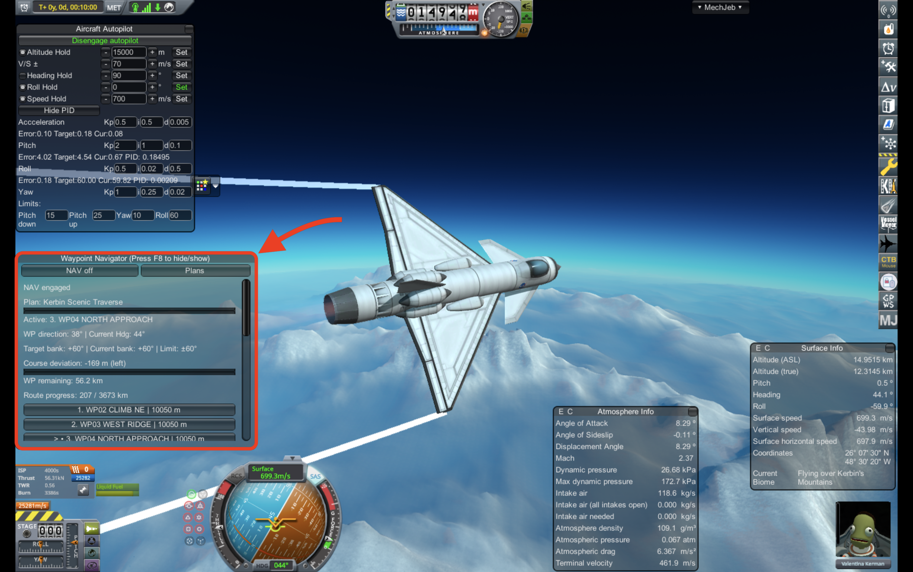

# MechJeb Waypoint Navigator

**Draw a flight route on a Kerbin map. Let your aircraft fly it automatically.**

- **Flight Plan Editor** — An interactive, offline map for creating routes and previewing turns.
- **Waypoint Navigator** — Follows your route using MechJeb Aircraft Autopilot.

[**Watch the demonstration on YouTube (6:27)**](https://youtu.be/7WIXcDXlVmw)

> Inspired by [RCTestFlight's waypoint missions](https://youtu.be/vYeYZpBE51I). Uses [Kramax directional guidance](https://forum.kerbalspaceprogram.com/topic/150846-112x-kramax-autopilot-continued-course-guidance-and-auto-land-for-spaceplanes/) and the high-resolution Kerbin map by [Smooneychad (Smooney Space)](https://smooney.space/mapdownloads/), redistributed with permission.
>
> Fallback map: [Micro Map by KerbalMissile](https://github.com/KerbalMissile/Micro-Map) (MIT license).

## Download & Install

**1. Download**

[**Download MechJeb-Waypoint-Navigator (ZIP)**](https://github.com/siyang03/MechJeb-Waypoint-Navigator/releases/latest/download/MechJeb-Waypoint-Navigator.zip)

**2. Install**

> ⚠️ Requires **KSP 1**, [MechJeb2](https://github.com/MuMech/MechJeb2), and [Harmony 2](https://github.com/KSPModdingLibs/HarmonyKSP) (available on CKAN).

Extract the ZIP and copy `MechJebWaypointNavigator` into your KSP `GameData` folder. On updates, preserve your existing CFG flight plans.

**3. Launch Flight Plan Editor**

Open `Launch the Editor.html` in **Chrome or Edge**. ⚠️ Firefox and Safari are not supported.

## Quick Start — Plan & Fly

**1. Draw your route**

Click the Kerbin map to add waypoints and drag them to adjust your route. Save your flight plan alongside `Example.cfg`.

<!--  -->

> An additional toggle shows 20 [Kerbin Side Remastered](https://spacedock.info/mod/1823/Kerbin%20Side%20Remastered) airfields with projected runway orientations.

**2. Set up MechJeb**

In flight, enable **MechJeb Aircraft Autopilot**.

Configure your desired altitude, speed, **BankAngle**, and **RollLimit**.

The Navigator's effective bank limit is **min(BankAngle, RollLimit)**.

**3. Engage navigation**

Open **Waypoint Navigator → Plans**, **Refresh**, and select your flight plan.

Press **NAV on**. Your aircraft will follow the waypoints automatically!

<!--  -->

## Good to Know

- **Altitude and speed:** NAV controls heading only. Set altitude and speed separately in MechJeb.
- **SAS:** NAV automatically manages SAS during flight. Manually toggling SAS or enabling MechJeb Heading Hold disengages NAV.
- **Turn predictions:** Estimated paths are not guarantees; sharp turns at high speeds may overshoot.
- **F8** toggles the Navigator window.

## Multi-Aircraft Navigation & Formation Flight

**Fly multiple aircraft simultaneously, each following its own flight plan!**

Simply engage NAV on each aircraft individually. Each aircraft remembers its own flight plan and navigation state.

- **Formation flying:** Use the same flight plan and bank angle limit, and **adjust speeds manually** to maintain formation.
- **Physics range:** Aircraft must remain within physics range. [Physics Range Extender (PRE)](https://github.com/jrodrigv/PhysicsRangeExtender) may help. Reengage NAV if an aircraft leaves physics range.
- **Limitations:** No automatic formation keeping or collision avoidance.

[Watch the multi-aircraft demonstration (6:27)](https://youtu.be/7WIXcDXlVmw) | [Full flight timelapse (11:20)](https://youtu.be/j17pTe91xRg)

## Development & Credits

`Source/` contains development code, tests, and documentation; it is not needed for installation. Building the Navigator requires .NET 8, Python 3, and a local KSP installation.

Diagnostic records appear in `KSP.log` during NAV.

See [LICENSE](LICENSE) and [THIRD_PARTY_NOTICES.md](THIRD_PARTY_NOTICES.md) for licensing and acknowledgments.
<!-- See [LICENSE](https://github.com/siyang03/MechJeb-Waypoint-Navigator/blob/main/LICENSE) and [THIRD_PARTY_NOTICES.md](https://github.com/siyang03/MechJeb-Waypoint-Navigator/blob/main/THIRD_PARTY_NOTICES.md) for licensing and acknowledgments. -->

MechJeb Waypoint Navigator is an independent add-on for MechJeb2 and is not affiliated with or endorsed by the MechJeb development team.

---

**AI Acknowledgment:** This project was developed with the assistance of [ChatGPT by OpenAI](https://chatgpt.com), including software design, implementation, debugging, testing, and documentation.
